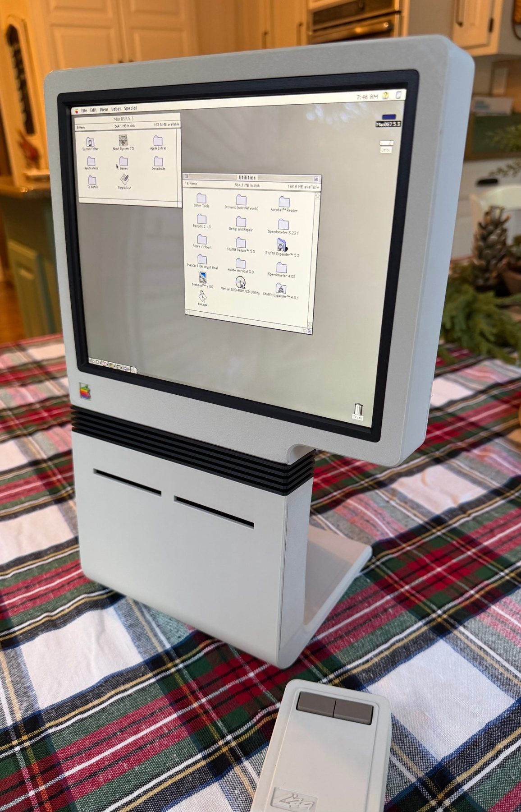
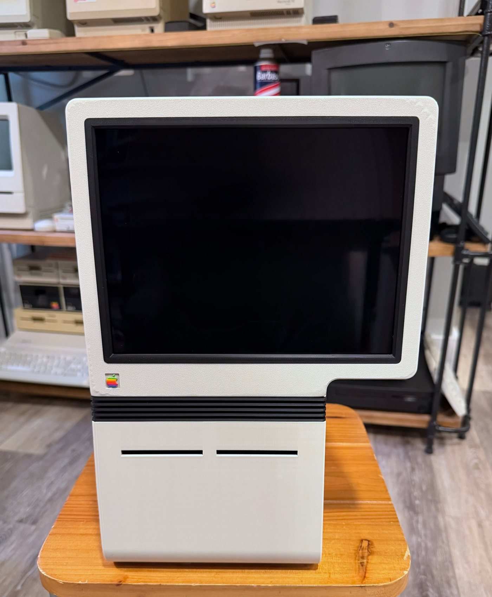
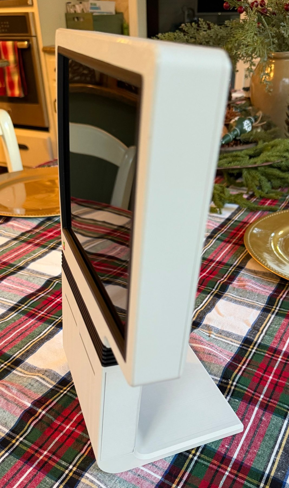
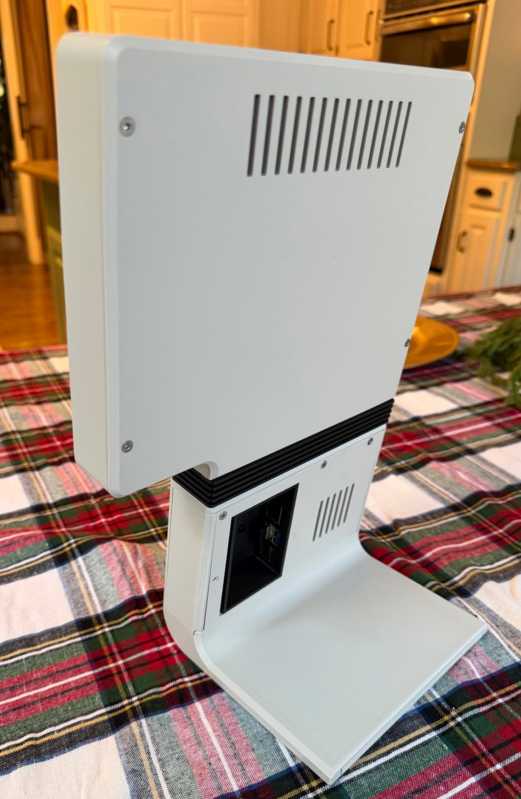
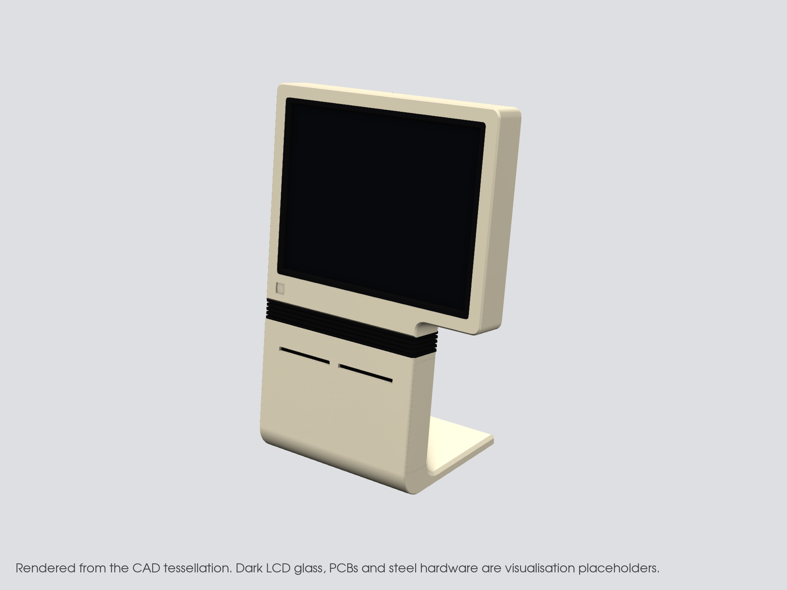
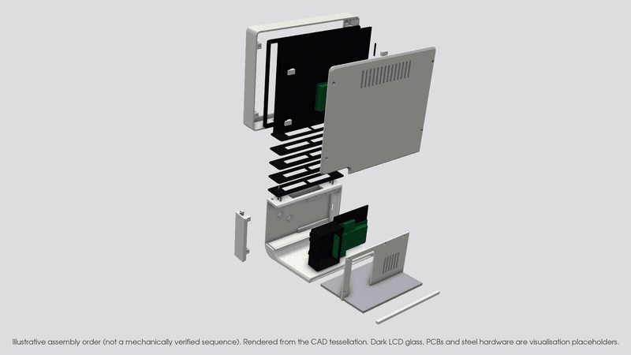

# Snow White Happy Pi

A thin, retro-styled desktop computer you can 3D print, with a 9.7" iPad LCD and a Raspberry Pi inside a light-coloured case. Black fins separate the display from the base, and the screen overhangs to one side. The design takes inspiration from a frog design concept from Apple's Snow White era that looks like one of the "Happy" designs. The source uses the working name SlimCase.

**Building one?** Start with the [bill of materials](docs/BOM.md) and [assembly guide](docs/ASSEMBLY.md). Download the [STLs](stl) or use the [four-plate Bambu Studio project](print/README.md). The printed case has **no built-in sound or external power switch**. I may add both in a future revision.



*The finished build uses a Raspberry Pi 5 and an iPad 3/4 LCD. The case is printed in Polar Filament Retro Platinum PLA and Sunlu black PLA.*

| Front | Side | Rear |
|---|---|---|
|  |  |  |



*Rendered from the CAD model. The dark LCD glass is a placeholder.*

## Assembly animation



*Illustrative order of assembly, rendered from the CAD (not a verified sequence). Full-quality video: [`media/slimcase_assembly_1080p.mp4`](media/slimcase_assembly_1080p.mp4) (12 s, 1080p).*

## At a glance

- 36 mm deep, 7° backward tilt, equal 18 mm bezel on all four sides.
- My build uses a 9.7" iPad 3/4 LCD. Older 9.7" iPad 1/2 LCDs also work. Use an HDMI controller matched to your exact panel. See the [BOM](docs/BOM.md#3-electronics) for the two options.
- A removable Raspberry Pi tray exposes USB, Ethernet and HDMI in a recess at the back, with an SD-card slot in the side. I built it with a Pi 5. The Pi 4 shares the mounting pattern and still needs an in-case fit check.
- Powered by one USB-C PD charger (12 V): a PD trigger board feeds a small 12 V to 5 V supply module that powers the Pi and the controller. The case has no power switch of its own; I put an inline USB-C power switch in the power cable (see the BOM).
- All parts fit a **250 × 250 mm** print bed in CAD (the largest footprint is 233 × 197 mm), with no supports by design. Hidden steel-bar ballast in the foot keeps it from tipping forward. Two bars laid crosswise at the back of the foot work best.
- Fully parametric: everything comes from one CadQuery script (`cad/slimcase.py`), so a different panel or Pi mostly means changing numbers.

## Status

I printed, assembled and ran a complete Pi 5 build. The files here are v0.9f. The [verification notes](docs/KNOWN_ISSUES.md) record the checks on individual revisions, including the side-cap hooks and ledge. Fit depends on the exact panel you have. Print the fit coupons and check your panel before printing the full housing.

## What's here

| Path | Contents |
|---|---|
| [`docs/BOM.md`](docs/BOM.md) | Printed parts, hardware, electronics, tools, links |
| [`docs/ASSEMBLY.md`](docs/ASSEMBLY.md) | Step-by-step build |
| [`docs/KNOWN_ISSUES.md`](docs/KNOWN_ISSUES.md) | Verification status, open questions |
| [`docs/SOFTWARE.md`](docs/SOFTWARE.md) | Display mode, emulator settings and performance findings from my Pi 5 build |
| [`docs/DESIGN.md`](docs/DESIGN.md) | Coordinate frames, what the CAD checks cover, stability estimate |
| [`docs/CHANGELOG.md`](docs/CHANGELOG.md) | Design history |
| [`docs/validation_report.txt`](docs/validation_report.txt) | Output of the automatic checks |
| [`print/`](print) | Ready-made Bambu Studio project (`SnowWhiteConcept.3mf`): all parts laid out on four plates for a 256 × 256 mm bed (everything also fits 250 × 250) |
| [`stl/`](stl) | Print-ready orientation, on Z=0; the file name carries the quantity (`__x4`). `stl/coupons/` has fit-test pieces |
| [`step/`](step) | Whole assembly and individual solid parts as STEP. Shim sets are in `stl/`. |
| [`cad/`](cad) | Source: parameters and geometry, export and validation, render scripts |
| [`media/`](media) | Renders and an exploded-assembly animation |

## Printing

1. **Print the coupons first** (`stl/coupons/`) if your printer, filament or inserts differ from mine: hole and heat-set insert fit, and the LCD pocket corner. Insert pilots were 4.0 mm for sideways holes and 4.2 mm for vertical ones; pin holes 3.3 mm.
2. Light parts are [Polar Filament Retro Platinum PLA](https://polarfilament.com/products/retro-platinum-pla-1kg-1-75mm), black parts are [Sunlu Hi-Speed black PLA](https://a.co/d/00ZGnC01). Any similar pair works. Use 0.2 mm layers for the LCD shims.
3. `lower_body` is the long print (about 130 × 150 × 170 mm, on its side).
4. **Bed size:** every part fits a 250 × 250 mm bed; the biggest footprints are the display housing and its rear cover at 233 × 197 mm, which leaves about 8 mm each side, so keep brims narrow on those two. [`print/`](print) has a four-plate Bambu Studio project (Bambu Lab A1, 0.4 mm nozzle, 0.2 mm layers) that you can use as is or as a guide.

## Rebuilding the CAD

Python 3.10+ is needed.

```bash
pip install -r cad/requirements.txt
python cad/export_all.py                 # writes out/: STEP, STL, validation report
python cad/render_vtk.py stills          # optional: still renders into out/renders
```

Parameters (panel size, margins, tolerances, fin count and so on) are at the top of `cad/slimcase.py`. `export_all.py` ends with the validation summary; every check should read PASS. `cad/blender_scene.py` is an untested optional script for building a Blender scene.

## Disclaimer

This is an independent hobby project. It is not made by, endorsed by or affiliated with Apple or frog design; names are used only to describe the inspiration. Electronics change between sellers, so check voltages and ratings yourself before wiring (the BOM lists what was used, not guarantees). The ballast is steel, and the case is top-heavy: keep it clear of edges while you test.

## License

[Creative Commons Attribution-NonCommercial-ShareAlike 4.0](LICENSE) (CC BY-NC-SA 4.0) for the code, CAD files, models and documents. You can build, modify and share it, with credit, under the same terms, but not for commercial use. If you build one, I'd love to see it.
